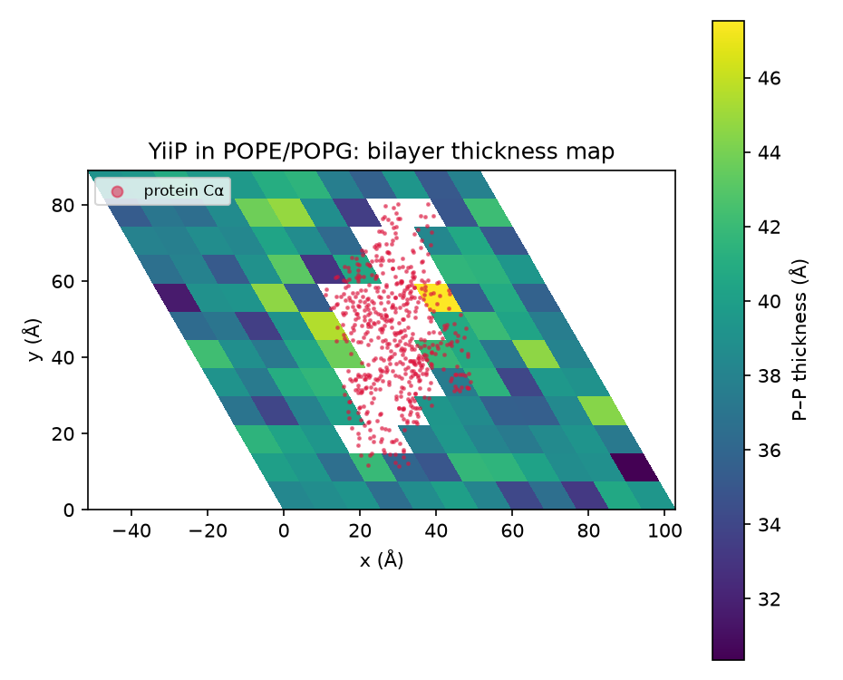
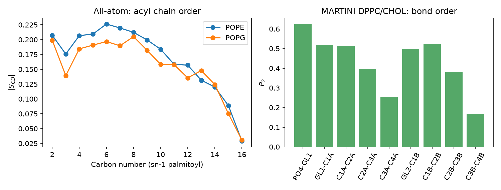
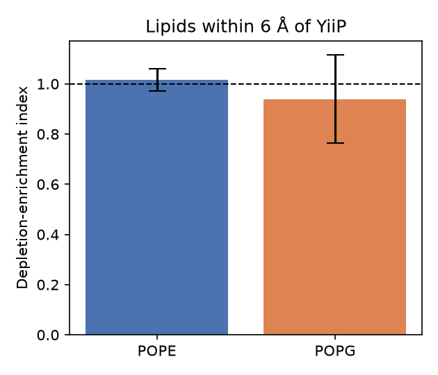

# md-membrane-analysis

A small, tested Python toolkit for analysing lipid bilayer simulations with
[MDAnalysis](https://www.mdanalysis.org/). It works with all-atom and MARTINI
coarse-grained systems, in orthorhombic or triclinic (for example hexagonal) boxes.

Author: Shadi Rahnama, Ph.D. (computational biophysics).

## What it computes

| Analysis | Function | Notes |
|---|---|---|
| Leaflet assignment | `assign_leaflets` | Splits headgroups by the bilayer midplane |
| Bilayer thickness | `mean_thickness`, `thickness_map` | Headgroup-to-headgroup distance, 2D map in triclinic boxes |
| Area per lipid | `area_per_lipid` | Optional subtraction of protein cross-section |
| Lipid enrichment around proteins | `depletion_enrichment` | Depletion-enrichment index, periodic boundaries respected |
| Acyl chain order (all-atom) | `scd_profile`, `charmm_sn1_pairs` | Deuterium order parameter \|S<sub>CD</sub>\| per carbon |
| Bond order (coarse-grained) | `bond_p2`, `martini_dppc_bonds` | Second-rank order parameter P<sub>2</sub> per bead pair |

## Example results

The demo uses two public test systems shipped with `MDAnalysisTests`:

1. **YiiP zinc transporter in a POPE/POPG membrane** (all-atom CHARMM36, 5 frames, 20 ns apart).
2. **DPPC/cholesterol bilayer** (MARTINI coarse-grained, 1 frame).

### Bilayer thickness around a membrane protein



Thickness from phosphate to phosphate, averaged over all frames and binned in fractional
box coordinates so the hexagonal cell is mapped correctly. Red dots show the protein Cα atoms.

### Acyl chain and coarse-grained bond order



Left: |S<sub>CD</sub>| of the palmitoyl (sn-1) chain, with the characteristic plateau of about
0.2 and the dip at carbon 3. Right: P<sub>2</sub> along the DPPC tails in the MARTINI bilayer,
decreasing toward the chain ends as expected.

### Lipid enrichment near the protein



The index is the fraction of a lipid type within 6 Å of the protein, divided by its
fraction in the whole membrane. With only 5 frames, neither lipid shows significant
enrichment. A real study would need much longer sampling.

### Summary numbers

| System | Quantity | Value |
|---|---|---|
| YiiP / POPE:POPG | P–P thickness | 36.6 to 41.7 Å |
| YiiP / POPE:POPG | Apparent area per lipid (includes protein area) | 65 to 78 Ų |
| MARTINI DPPC/CHOL | PO4–PO4 thickness | 40.5 Å |
| MARTINI DPPC/CHOL | Area per molecule (DPPC + CHOL) | 57.8 Ų |

Full tables are written to `results/`.

## Installation

```bash
python -m venv .venv
source .venv/bin/activate
pip install -r requirements.txt
```

## Usage

Run the demo:

```bash
python run_demo.py            # writes results/ and figures/
python run_demo.py --cutoff 8 # different enrichment cutoff
```

Use it on your own trajectory:

```python
import MDAnalysis as mda
from membrane_analysis import assign_leaflets, mean_thickness, depletion_enrichment

u = mda.Universe("system.psf", "trajectory.dcd")
heads = u.select_atoms("name P")
lipids = u.select_atoms("resname POPC POPS and not name H*")
protein = u.select_atoms("protein and not name H*")

for ts in u.trajectory[::10]:
    upper = assign_leaflets(heads.positions[:, 2])
    print(ts.time,
          mean_thickness(heads.positions[upper, 2], heads.positions[~upper, 2]),
          depletion_enrichment(lipids, protein, cutoff=6.0))
```

## Tests

```bash
pytest
```

The tests use small synthetic systems with known answers: flat bilayers, bonds
crossing the periodic boundary, and a known enrichment pattern.

## Limitations

- Leaflet assignment assumes a flat bilayer centred in the box. For vesicles or strongly
  curved membranes, use `MDAnalysis.analysis.leaflet.LeafletFinder` instead.
- The membrane normal is assumed to be the z axis.

## Data

Test structures and trajectories come from the
[MDAnalysisTests](https://github.com/MDAnalysis/mdanalysis/tree/develop/testsuite) package
(GPL licensed) and are downloaded automatically with `pip install MDAnalysisTests`.

## Need membrane or protein simulations?

I offer MD setup, simulation, and analysis for proteins, membranes, and protein-ligand
systems (all-atom and MARTINI). Contact: master.shadi@gmail.com
